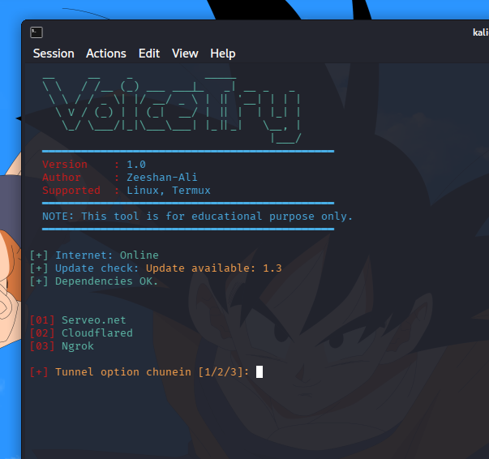

# VoiecTry 
Voicetry is a online real time hacking tool which is used for Capturing audio (.wav) from target via a link with Serveo.net , Cloudflared and Ngrok Tunnels.
<br>
<p align="center">
  
</p>

### How it works?

After the user grants microphone permissions, a website redirect button of your choice is released to distract the target while small audio files (about 4 seconds in wav format) are sent to the attacker.
It uses Recorderjs, plugin for recording/exporting the output of Web Audio API nodes (https://github.com/mattdiamond/Recorderjs)

### Features:

Port Forwarding using Serveo or cloudflared and Ngrok comming soon 

### Legal disclaimer:

Usage of Voicetry for attacking targets without prior mutual consent is illegal. It's the end user's responsibility to obey all applicable local, state and federal laws. Developers assume no liability and are not responsible for any misuse or damage caused by this programme

## requirements
<p>This tool require PHP for webserver, and wget for downloading dependencies. First run following command on your terminal</p>

### For Linux
```$ apt update && apt upgrade -y```<br>
```$ apt-get -y install php wget unzip && apt-get -y install bash```<br>

### For Termux

```$ pkg update && pkg upgrade -y```<br>
```$ pkg-get -y install php wget unzip && pkg-get -y install bash ```<br>

## Installing (Kali Linux/Termux):

```$ git clone https://github.com/Zeeshan-78/VoiceTry.git```<br>
```$ cd VoiceTry```<br>
```$ chmod +x voicetry.sh```<br>
```$ bash voicetry.sh```<br>

### This tool is created for educational purpose, if misuse the tool you are responsible.
 
 Created by Zeeshan Ali 
